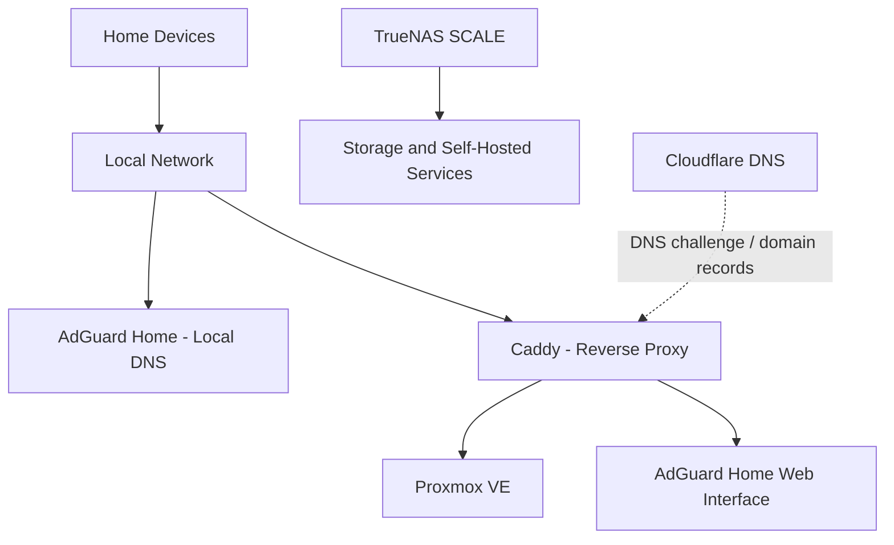

# 🏠 My Homelab

Welcome to my homelab project! This repository documents my journey building, configuring, securing, and maintaining a home IT environment. It is a hands-on learning space where I practise system administration, networking, virtualisation, self-hosting, DNS, and reverse-proxy configuration.

## 🎯 Project Goals

- Build practical experience with networking and IT infrastructure.
- Learn to deploy and manage virtual machines, storage, and self-hosted services.
- Configure reliable local DNS and secure access to internal services.
- Use HTTPS and a reverse proxy to make services easier to reach on my local network.
- Document configurations, troubleshooting steps, and lessons learned for future reference.

## 🧰 Current Technology Stack

| Technology | Purpose |
| --- | --- |
| **Proxmox VE** | Virtualisation and management of virtual machines and containers. |
| **TrueNAS SCALE** | Network-attached storage and storage management. |
| **Debian** | Linux host for network services and reverse-proxy tools. |
| **Caddy** | Reverse proxy and HTTPS/TLS management for selected services. |
| **Cloudflare** | Domain DNS management and DNS-based validation for certificate issuance. |
| **AdGuard Home** | Local DNS filtering and network-wide ad/tracker blocking. |
| **Nextcloud** | Self-hosted file storage and collaboration (setup and testing documented as it develops). |

> The setup is evolving, so services and configurations may change as I learn and improve the environment.

## 🗺️ High-Level Design



This is a simplified overview rather than a complete network diagram. Only the services and access paths that are configured and tested are intended to be active.

## 🔐 Security Principles

- Keep management interfaces on the trusted home network wherever possible.
- Do not publish passwords, API tokens, private keys, `.env` files, or other secrets in this repository.
- Avoid committing private IP details, sensitive DNS records, or configuration exports that reveal more about the network than necessary.
- Use HTTPS for supported web interfaces and review certificate and proxy settings carefully.
- Keep systems updated and back up important configuration and data.
- Treat Cloudflare DNS configuration and a reverse proxy as separate from a VPN; do not assume a service is private solely because it uses a domain name.

## 📚 What I’m Learning

- Linux administration and service management with `systemd`.
- Virtualisation and storage management.
- DNS records, local name resolution, and troubleshooting.
- Reverse-proxy configuration with Caddy.
- HTTPS certificates and DNS-based certificate validation.
- Secure access to internal services and network troubleshooting.
- Writing clear technical documentation and maintaining configuration backups.

## 🛣️ Planned Improvements

- [ ] Finish testing access to services from multiple devices on the local network.
- [ ] Document the network layout and service dependencies.
- [ ] Add backup and recovery procedures for important services.
- [ ] Improve monitoring, logging, and routine maintenance.
- [ ] Record common issues and their solutions in a troubleshooting guide.
- [ ] Review remote-access options before making any service reachable from outside the home network.

## 📁 Repository Structure

The repository may grow to include documentation and sanitised examples such as:

```text

├── README.md

 
```

## 📝 Documentation Approach

For each service, I aim to record its purpose, prerequisites, setup steps, important configuration choices, verification commands, troubleshooting notes, and backup or recovery steps. Any configuration shared publicly will be reviewed and sanitised first.

---

**Note:** This repository is a learning and documentation project. Hostnames, network details, service availability, and configurations may change as the homelab develops.
